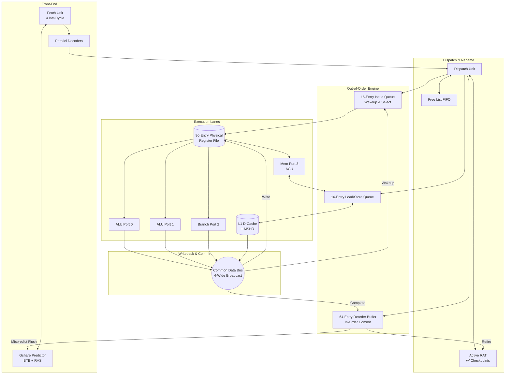

# RV32I 4-Wide Superscalar Out-of-Order Core

This repository contains the SystemVerilog RTL for a high-performance, 4-wide superscalar Out-of-Order (OoO) RISC-V processor. Designed strictly from the bottom-up for FPGA synthesis, the core implements a fully dynamic Tomasulo scheduling engine, aggressive speculative execution, and exact architectural state recovery.

The microarchitecture decouples the front-end fetch from the execution engine, utilizing a massive Physical Register File (PRF), associative Wakeup/Select logic, and a Load-Store Queue (LSQ) with speculative memory disambiguation to overlap memory latency with raw compute.

## Overall Microarchitecture Block Diagram



## Core Specifications
* **ISA:** RV32I (Base Integer Instruction Set)
* **Fetch/Decode/Dispatch Width:** 4 Instructions per cycle
* **Execution Width:** 4 Asymmetric Ports (2x ALU, 1x Branch, 1x Memory)
* **Commit Width:** Up to 4 Instructions per cycle (In-Order)
* **Reorder Buffer (ROB):** 64 Entries
* **Issue Queue (IQ):** 16 Entries
* **Physical Register File (PRF):** 96 Entries (Multi-ported SRAM)
* **Branch Prediction:** Gshare (8-bit BHR) with 64-entry BTB and 16-entry Return Address Stack (RAS)

## Hardware Engineering Highlights
### 1. Zero-Cycle Speculation Recovery (RAT Checkpointing)
Rather than relying on the Reorder Buffer to slowly walk back mispredicted paths over multiple clock cycles, the Active Register Alias Table (RAT) takes a physical checkpoint of its mappings every time a branch is dispatched. Upon branch misprediction, the active RAT is overwritten by the saved checkpoint in exactly 0 clock cycles, completely hiding the recovery latency from the front-end.

### 2. Dynamic Ghost Instruction Filtering
Because the pipeline is deeply superscalar, a branch misprediction can result in dozens of wrong-path instructions flooding the Issue Queue and LSQ before the flush signal resolves. The core utilizes relative age-checking logic against the ROB Head Pointer to dynamically annihilate these ghost instructions inside the active queues without leaking Physical Register tags or corrupting valid, older instructions.

### 3. Store-to-Load Forwarding (Memory Disambiguation)
The Load-Store Queue (LSQ) prevents severe memory hazards by enforcing age-based ordering. When a Load calculates its address, it searches older, uncommitted Stores waiting in the LSQ. If a Write-After-Read (RAW) address collision is detected, the LSQ bypasses the L1 Cache entirely, extracting the raw byte/halfword data, applying proper sign-extension, and forwarding it directly to the Common Data Bus.

### 4. Non-Blocking L1 Data Cache
In-order cores freeze on a cache miss. This core features Miss Status Holding Registers (MSHRs). If a Load misses the cache, it yields the memory bus but remains in the Issue Queue/LSQ, allowing younger, independent arithmetic instructions to continue executing out-of-order while the data is fetched from main memory.

## Directory Structure

```text
RV32I-Superscalar-OoO/
  ├── rtl/                      # Synthesizable SystemVerilog RTL
  │   ├── core/                 # execution_engine, fetch, decode, rat, rob, iq, lsq
  │   ├── memory/               # mshr, dcache, iram, prf_wrapper, multiport_sram
  │   ├── include/              # rv32i_types_pkg.sv
  │   ├── top/                  # superscalar_core_top.sv
  │   └── tb/                   # Simulation Testbenches
  │       └── tb_superscalar_core_top.sv
  ├── .gitignore
  └── README.md
```

## Simulation & Testing
The provided testbench (`tb_superscalar_core_top.sv`) executes a dense, highly specialized assembly sequence designed to thrash the microarchitecture and intentionally trigger structural hazards, pipeline flushes, and memory collisions:
* **Phase 1-4 (RAW/WAW/WAR Blasts):** Exhausts the Free List and saturates the PRF to test stall conditions and register renaming integrity.
* **Phase 5-6 (Gshare & RAS Thrashing):** 10-level deep nested subroutine calls (`JAL`/`JALR`) to saturate the global history register and force Return Address Stack overflows.
* **Phase 7 (0-Cycle Rollback):** A checkpoint stress test that intentionally mispredicts a branch, floods the Issue Queue with dummy arithmetic, and verifies that the architectural pointers successfully recover exactly to 0 upon resolution.
* **Phase 8 (CAM Collision):** Forces a precise byte-level load (`LB`) to the exact address of an uncommitted store word (`SW`), proving the LSQ's ability to extract and sign-extend bypassed cache data.

## Synthesis Considerations
This core is structured for high-performance synthesis on modern FPGA fabrics (e.g., Xilinx Artix-7/Kintex-7).
* The Physical Register File (PRF) utilizes a wrapper (`multiport_sram.sv`) designed to infer Distributed RAM (LUTRAM) to meet the massive read/write port requirements of a 4-wide machine, avoiding severe BRAM port-collision routing constraints.
* All associative arrays (IQ Wakeup matrices, LSQ CAM) are strictly bounded to 16 entries to achieve optimal timing closure without catastrophic fan-out.

## Future Roadmap
- [ ] **Precise Exceptions:** Implement privileged CSRs (`mstatus`, `mepc`, `mcause`) to catch traps/interrupts at the ROB head, enabling RTOS support.
- [ ] **RV32M Extension:** Add a multi-cycle iterative Radix-2 divider and pipelined multiplier to the execution lanes.
- [ ] **Unified AXI4 Bus:** Replace idealized BRAM cache models with standard AXI4-Lite memory controllers for external DDR access.
